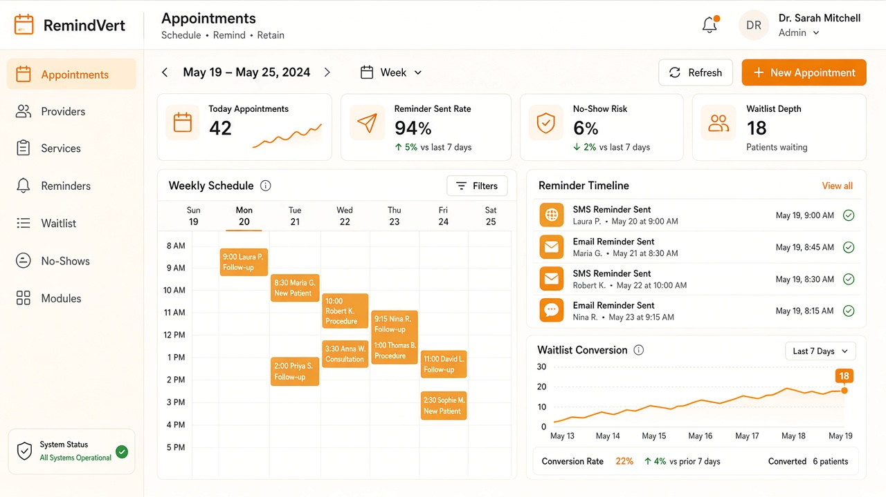

# Vertical Appointment & Reminder System



**SEO title:** Vertical Appointment & Reminder System — Smart Scheduling, SMS/Email Reminders & No-Show Reduction  
**SEO description:** Vertical appointment and reminder system with smart scheduling, no-show reduction, SMS/email reminders, and waitlist automation for clinics and services.

**Keywords:** appointment reminder system, clinic scheduling software, SMS appointment reminders, waitlist automation, no-show reduction, Laravel Filament bookings, vertical appointment SaaS

---

## Why this product

Front desks still chase confirmations in spreadsheets while empty chairs burn revenue. **AppointRemind (Vertical Appointment & Reminder System)** ships smart scheduling, multi-channel reminders, waitlist fill, and no-show risk scoring — with modular toggles so clinics, dental, physio, and service businesses enable only what they need.

### Business ROI / time saver

| Pain today | With AppointRemind |
|---|---|
| Double-booked providers | Conflict-aware slots + availability windows |
| Manual reminder calls | SMS/email templates with delivery tracking |
| Cancellations leave dead air | Priority waitlist auto-offers |
| No-shows discovered too late | Risk scoring + confirmation workflows |
| Buying tools you do not need | Modular toggles — turn modules on/off per business |

**Demo model:** reclaim **~200+ hours/week** across enabled modules at a blended front-desk rate, with ROI surfaced on the public pricing page and amber admin widgets.

---

## Stack

- PHP Laravel (latest stable) + Filament admin (`#D97706` amber accent)
- Modular feature flags (modules on/off; core scheduling modules protected)
- Multi-role users: Super Admin, Admin, Manager, Staff/Provider, Client/Patient, Demo
- Public marketing pages for features, modules, scheduling, reminders, waitlist, pricing, demo + client portal
- Packagist packages from [imrandevbd](https://packagist.org/packages/imrandevbd/)

### Required packages

- `imrandevbd/drutogoti` — speed layer
- `imrandevbd/laravel-admin-panel` — admin panel foundations
- `imrandevbd/laravel-ai-catalog` — service catalog scrape assist
- `imrandevbd/laravel-ai-hub` — AI scheduling / copy assist wiring
- `imrandevbd/laravel-attendance-hub` — staff attendance bridge
- `imrandevbd/laravel-unicode-pdf` — multilingual appointment PDF packs
- `imrandevbd/laravel-universal-slug` — Unicode-safe slugs for services & templates

**Laravel 13 note:** `drutogoti`, `laravel-admin-panel`, `laravel-attendance-hub`, and `laravel-ai-catalog` ship as path shims under `packages/*` that require `illuminate/support` `^11|^12|^13` (catalog also relaxes the ai-hub constraint) so Composer resolves cleanly while all seven packages remain declared in `composer.json`.

---

## Modules (toggle on/off)

| Key | Module | Category | Core |
|---|---|---|---|
| `appointments` | Appointments | operations | Yes |
| `scheduling` | Smart Scheduling | operations | Yes |
| `reminders` | SMS & Email Reminders | engagement | Yes |
| `waitlist` | Waitlist Automation | operations | Yes |
| `no_show` | No-Show Reduction | quality | Yes |
| `services` | Service Catalog | catalog | No |
| `providers` | Providers & Staff | workforce | No |
| `client_portal` | Client Portal | engagement | No |
| `ai_scheduling` | AI Scheduling Assist | ai | No |
| `pdf_exports` | Unicode PDF Exports | reporting | No |
| `catalog_scrape` | Service Catalog Scraper | data | No (off by default) |
| `attendance_ops` | Staff Attendance | workforce | No (off by default) |
| `speed_optimizer` | Drutogoti Speed Layer | platform | No |

---

## Domain features

- **Appointments** — references, statuses, locations, confirmation flags
- **Smart scheduling** — weekday availability, duration + buffer, conflict checks
- **Reminders** — SMS/email/both templates, scheduled send, delivery simulation
- **Waitlist** — priority queue, timed offers on cancellations
- **No-show reduction** — client risk scores, appointment risk, mark no-show flows
- **Services & providers** — catalog pricing, specialties, capacity
- **Client portal** — upcoming visits + waitlist status
- **Module toggles** — Filament module matrix + env defaults
- **Multi-role Filament admin** — amber `#D97706` AppointRemind dashboard

---

## Demo users

Password for all accounts: value of DEMO_PASSWORD in .env (default password).

| Role | Email |
|---|---|
| Super Admin | admin@appointremind.test |
| Admin | ops-admin@appointremind.test |
| Manager | manager@appointremind.test |
| Staff / Provider | staff@appointremind.test |
| Client | client@appointremind.test |
| Demo | demo@appointremind.test |

Admin panel: `/admin` · Marketing: `/` · Portal: `/portal`

---

## Quick start

```bash
composer install --no-scripts
cp .env.example .env
php artisan key:generate
touch database/database.sqlite
php artisan filament:upgrade
php artisan migrate --seed
php artisan serve
```

### Docker

```bash
docker compose up -d --build
```

App on `http://localhost:8080` (MySQL published on `3307`).

---

## Author

**Imran Ahmed** · [me@imrandev.bd](mailto:me@imrandev.bd) · [https://imrandev.bd](https://imrandev.bd)

---

## 🤝 Let's Connect & Collaborate

I am open to Senior Remote Full-Stack Roles, AI Platform Architecture Contracts, and Enterprise Technical Advisory.

Timezone: UTC+6 (Dhaka / Rangpur, Bangladesh) — Flexible overlap with US, UK, and European business hours.

Delivery Mode: Async-ready, Slack, Discord, Jira, GitHub, and production-first accountability.

| Channel | Address / Handle | Quick Action |
|---|---|---|
| 🌐 Primary Portfolio | [imrandev.bd](https://imrandev.bd) | [Visit Site ↗](https://imrandev.bd) |
| 📦 Packagist Packages | [packagist.org/packages/imrandevbd/](https://packagist.org/packages/imrandevbd/) | [View Packages ↗](https://packagist.org/packages/imrandevbd/) |
| 💼 LinkedIn Profile | [linkedin.com/in/imranbru99](https://linkedin.com/in/imranbru99) | [Connect ↗](https://linkedin.com/in/imranbru99) |
| 🐙 GitHub Profile | [github.com/imranbru99](https://github.com/imranbru99) | [Follow ↗](https://github.com/imranbru99) |
| 💬 WhatsApp Direct | +880 1576-918420 | [Chat Now ↗](https://wa.me/8801576918420) |
| 📧 Direct Email | me@imrandev.bd | [Send Email ↗](mailto:me@imrandev.bd) |
| 🐦 X (Twitter) | [@imrandev_bd](https://x.com/imrandev_bd) | [Follow ↗](https://x.com/imrandev_bd) |
| 📺 YouTube Tech | [@ImranDevBD](https://youtube.com/@ImranDevBD) | [Subscribe ↗](https://youtube.com/@ImranDevBD) |
